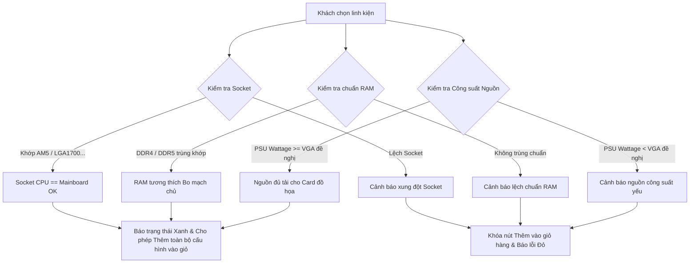
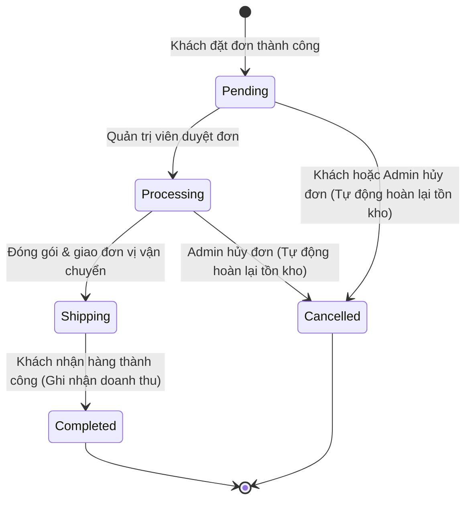
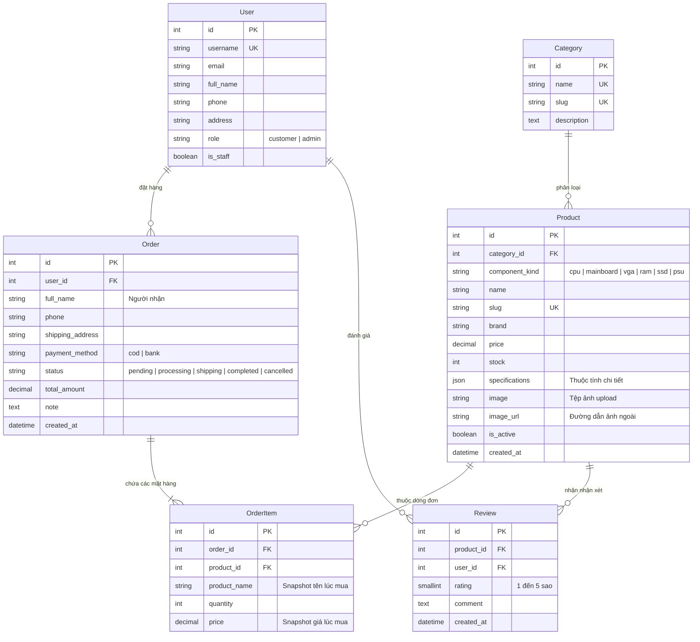

# 🖥️ PCShop — Hệ Thống Website Thương Mại Điện Tử & Quản Lý Linh Kiện Máy Tính

<p align="center">
  
  
  
  
  
  
</p>

---

## 📖 Giới thiệu tổng quan

**PCShop** là nền tảng thương mại điện tử chuyên biệt dành cho ngành hàng máy tính, laptop và linh kiện phần cứng công nghệ cao. Dự án được xây dựng trên nền tảng **Python / Django**, tích hợp **Django REST Framework (DRF)**, đáp ứng đầy đủ cả hai khía cạnh:
1. **Cửa hàng trực tuyến (Storefront)**: Trải nghiệm mua sắm hiện đại, bộ lọc thông số linh kiện chuyên sâu, tính năng so sánh đa sản phẩm, đặc biệt là **bộ dựng cấu hình máy tính (PC Builder)** với thuật toán tự động kiểm tra tương thích phần cứng.
2. **Khu vực quản trị thông minh (Management Dashboard & Admin)**: Báo cáo doanh thu trực quan bằng biểu đồ, cảnh báo tồn kho thấp theo ngưỡng, xử lý quy trình đơn hàng khép kín chống race-condition và quản lý danh mục sản phẩm động.

> 💡 **Mục đích dự án:** Đồ án / Bài tập lớn môn học **Lập trình với Python**, được thiết kế theo các tiêu chuẩn kiến trúc phần mềm clean code (MVT kết hợp Service Layer, Database Transactions, Concurrency-safe, RESTful API).

---

## 📑 Mục lục

- [1. Tính năng nổi bật](#-1-tính-năng-nổi-bật)
  - [1.1. Dành cho Khách hàng (Storefront)](#11-dành-cho-khách-hàng-storefront)
  - [1.2. Tính năng Dựng cấu hình PC (PC Builder)](#12-tính-năng-dựng-cấu-hình-pc-pc-builder)
  - [1.3. Dành cho Quản trị viên & Nhân viên (Dashboard)](#13-dành-cho-quản-trị-viên--nhân-viên-dashboard)
  - [1.4. Quy tắc nghiệp vụ cốt lõi](#14-quy-tắc-nghiệp-vụ-cốt-lõi)
- [2. Kiến trúc & Công nghệ sử dụng](#-2-kiến-trúc--công-nghệ-sử-dụng)
- [3. Cấu trúc thư mục dự án](#-3-cấu-trúc-thư-mục-dự-án)
- [4. Thiết kế Cơ sở dữ liệu (Database Schema)](#-4-thiết-kế-cơ-sở-dữ-liệu-database-schema)
- [5. Hướng dẫn Cài đặt & Khởi chạy](#-5-hướng-dẫn-cài-đặt--khởi-chạy)
  - [5.1. Yêu cầu hệ thống](#51-yêu-cầu-hệ-thống)
  - [5.2. Cài đặt nhanh trên Windows](#52-cài-đặt-nhanh-trên-windows)
  - [5.3. Cài đặt trên Linux & macOS](#53-cài-đặt-trên-linux--macos)
  - [5.4. Cấu hình biến môi trường (.env)](#54-cấu-hình-biến-môi-trường-env)
  - [5.5. Khởi tạo tài khoản Quản trị](#55-khởi-tạo-tài-khoản-quản-trị)
- [6. Hướng dẫn Đăng nhập Mạng Xã Hội (OAuth2)](#-6-hướng-dẫn-đăng-nhập-mạng-xã-hội-oauth2)
- [7. Quy chuẩn Dữ liệu Thông số Kỹ thuật & Nhóm Linh kiện](#-7-quy-chuẩn-dữ-liệu-thông-số-kỹ-thuật--nhóm-linh-kiện)
- [8. Tài liệu REST API](#-8-tài-liệu-rest-api)
- [9. Hướng dẫn Triển khai Production](#-9-hướng-dẫn-triển-khai-production)
- [10. Kiểm thử & Đảm bảo chất lượng (Testing)](#-10-kiểm-thử--đảm-bảo-chất-lượng-testing)
- [11. Xử lý sự cố thường gặp (Troubleshooting)](#-11-xử-lý-sự-cố-thường-gặp-troubleshooting)

---

## 🌟 1. Tính năng nổi bật

### 1.1. Dành cho Khách hàng (Storefront)
- **Duyệt sản phẩm đa cấp độ:**
  - 6 danh mục cốt lõi: *Laptop, PC văn phòng, PC gaming, Màn hình, Phụ kiện PC, Linh kiện PC*.
  - Riêng danh mục **Linh kiện PC** có bộ phân loại nhanh 6 nhóm: **CPU, Mainboard, VGA (Card màn hình), RAM, SSD (Ổ cứng), Nguồn (PSU)**.
- **Bộ lọc đa diện thông minh (Faceted Search & Dynamic Filtering):**
  - Lọc theo khoảng giá linh hoạt (tùy biến theo từng loại sản phẩm, ví dụ PC văn phòng có dải giá khác PC gaming).
  - Lọc theo thương hiệu (hệ thống tự động chỉ hiển thị các thương hiệu tồn tại trong danh mục tương ứng).
  - Lọc sâu theo thông số kỹ thuật phần cứng: Socket (AM4, AM5, LGA1700...), Chipset (B760, Z790, B650...), Chuẩn RAM (DDR4, DDR5), Dung lượng (8GB, 16GB, 1TB...), GPU (RTX 4060, RX 7600...), Công suất PSU (550W, 750W...).
  - Tìm kiếm từ khóa theo tên, thương hiệu hoặc thuộc tính thông số.
  - Sắp xếp linh hoạt: Mới nhất, Giá tăng dần, Giá giảm dần, Tên A-Z.
- **Trang chi tiết sản phẩm:**
  - Hiển thị hình ảnh độ phân giải cao (hỗ trợ cả ảnh tải lên hệ thống lẫn liên kết URL ngoài).
  - Tình trạng kho hàng thời gian thực (Còn hàng / Hết hàng).
  - Bảng thông số kỹ thuật chi tiết trình bày rõ ràng, chuẩn hóa.
  - Hệ thống đánh giá sao (1 - 5★) và bình luận: Chỉ những khách hàng đã mua và có đơn hàng hoàn thành mới được phép gửi đánh giá (tránh đánh giá ảo).
- **So sánh sản phẩm (Compare):**
  - Cho phép người dùng thêm và đối chiếu thông số tối đa **4 sản phẩm** cùng lúc trên bảng so sánh trực quan.
- **Giỏ hàng & Đặt hàng (Cart & Checkout):**
  - Giỏ hàng lưu trữ theo Session, tự động tính tổng tiền và cập nhật số lượng trực tiếp qua AJAX / Fetch API.
  - Kiểm tra tồn kho ngay khi thay đổi số lượng trong giỏ và xác thực lại lần cuối tại bước Checkout.
  - Hỗ trợ 2 phương thức thanh toán: **COD (Thanh toán khi nhận hàng)** và **Chuyển khoản ngân hàng** (hiển thị thông tin STK, chủ tài khoản và cú pháp chuyển tiền).
- **Quản lý đơn hàng & Tài khoản cá nhân:**
  - Theo dõi danh sách đơn hàng đã mua và xem chi tiết từng đơn hàng (bao gồm snapshot giá và tên tại thời điểm đặt).
  - Quyền tự hủy đơn hàng: Khách hàng được phép tự hủy đơn khi đơn vẫn ở trạng thái **Chờ xác nhận (Pending)**.
  - Cập nhật thông tin hồ sơ: Họ tên, số điện thoại, địa chỉ nhận hàng mặc định.
  - Đa dạng phương thức đăng nhập: Tài khoản mật khẩu cục bộ, hoặc đăng nhập 1-click qua **Google, Facebook, Zalo**.

---

### 1.2. Tính năng Dựng cấu hình PC (PC Builder)
Tính năng cao cấp hỗ trợ khách hàng tự chọn từng linh kiện để lắp ráp một bộ máy tính hoàn chỉnh tại `/pc-builder/`. Hệ thống tích hợp sẵn **Engine kiểm tra tương thích phần cứng (`catalog/compatibility.py`)**:



- **Quy tắc kiểm tra tự động:**
  1. **Socket CPU & Mainboard:** Trích xuất tự động socket (ví dụ `AM4`, `AM5`, `LGA1700`, `LGA1200`) qua Regex để đảm bảo CPU gắn vừa Socket bo mạch chủ.
  2. **Chuẩn RAM & Bo mạch chủ:** Đối soát chuẩn bộ nhớ (DDR4 / DDR5) giữa thanh RAM đã chọn và các chuẩn mà bo mạch chủ hỗ trợ.
  3. **Công suất Nguồn (PSU) & Card đồ họa (VGA):** Đọc công suất khuyến nghị từ thông số VGA và so khớp với công suất định danh của Nguồn để ngăn chặn sụt nguồn khi tải nặng.
- **Xử lý trạng thái trực quan:**
  - `success` (Xanh lục): Xác nhận phần cứng hoàn toàn tương thích.
  - `warning` (Vàng): Thiếu dữ liệu thông số để khẳng định 100% (cho phép xem xét thêm).
  - `danger` (Đỏ): Xung đột phần cứng nghiêm trọng — hệ thống sẽ chặn hành động thêm cả bộ vào giỏ hàng nhằm bảo vệ khách hàng khỏi việc mua nhầm linh kiện không lắp ráp được.

---

### 1.3. Dành cho Quản trị viên & Nhân viên (Dashboard)
Truy cập tại URL: `/manage/` (yêu cầu tài khoản có quyền `is_staff=True` hoặc `role='admin'`):
- **Bảng điều khiển tổng quan (Analytics Dashboard):**
  - Thống kê doanh thu thực tế (chỉ ghi nhận từ các đơn hàng ở trạng thái **Hoàn thành**).
  - Biểu đồ đường trực quan hóa doanh thu và số lượng đơn hàng theo chu kỳ ngày (tùy chọn 7 ngày, 30 ngày, 90 ngày) sử dụng thư viện **Chart.js**.
  - Bảng thống kê Top sản phẩm bán chạy nhất kèm tổng doanh thu tương ứng.
  - Thẻ đếm số lượng đơn hàng phân loại theo từng trạng thái.
  - **Cảnh báo tồn kho thấp (Low Stock Alert):** Tự động phát hiện các mặt hàng có số lượng tồn kho $\le 5$ (ngưỡng có thể cấu hình qua `LOW_STOCK_THRESHOLD`) để kịp thời nhập hàng.
- **Quản lý danh mục:**
  - Thêm, sửa, xóa danh mục. Tự động sinh `slug` chuẩn tiếng Việt không dấu (xử lý tốt ký tự đặc thù như `đ`, `Đ`).
- **Quản lý sản phẩm linh hoạt:**
  - Nhập thông số kỹ thuật thân thiện dạng từng dòng văn bản `Khóa: Giá trị` — hệ thống tự động chuyển hóa thành JSON có cấu trúc trong Database.
  - Lựa chọn nhóm linh kiện con (`component_kind`) nhanh chóng.
  - Hỗ trợ tải tệp ảnh lên lưu trữ tại thư mục máy chủ hoặc dán đường dẫn ảnh URL trực tiếp từ internet.
  - Cơ chế **Xóa mềm (Soft protection):** Sản phẩm đã phát sinh trong đơn hàng của khách sẽ được hệ thống chuyển sang trạng thái ngưng kinh doanh (`is_active=False`) thay vì xóa cứng khỏi Database, giúp đảm bảo toàn vẹn dữ liệu kế toán và hóa đơn.
- **Quản lý quy trình đơn hàng:**
  - Xem chi tiết hóa đơn, thông tin người nhận, địa chỉ giao hàng và phương thức thanh toán.
  - Chuyển tiếp trạng thái đơn hàng theo luồng nghiệp vụ khép kín.

---

### 1.4. Quy tắc nghiệp vụ cốt lõi



1. **Trừ tồn kho nguyên tử (Concurrency-Safe Inventory Deduction):**
   - Khi tạo đơn hàng, hệ thống sử dụng `Product.objects.filter(pk=pid, stock__gte=qty).update(stock=F("stock") - qty)`.
   - Kết hợp bọc trong `@transaction.atomic`. Nếu nhiều người cùng mua sản phẩm cuối cùng tại một thời điểm, chỉ một người thành công, các giao dịch còn lại sẽ được rollback hoàn toàn và nhận thông báo lỗi tồn kho rõ ràng, loại bỏ hoàn toàn hiện tượng bán âm kho (Overselling / Race condition).
2. **Snapshot hóa đơn:**
   - Dòng chi tiết đơn hàng (`OrderItem`) lưu giữ bản sao bất biến của `product_name` và `price` tại thời điểm mua. Mọi thay đổi về giá hoặc sửa đổi tên linh kiện trong tương lai đều không làm sai lệch lịch sử giao dịch và doanh thu đã chốt.
3. **Hoàn tồn kho tự động (Auto Restocking):**
   - Khi một đơn hàng đang ở trạng thái `pending` hoặc `processing` bị chuyển sang `cancelled`, hệ thống tự động cộng hoàn lại chính xác số lượng tồn kho cho các sản phẩm trong đơn.
4. **Quy tắc đánh giá minh bạch:**
   - Chỉ tài khoản có đơn hàng chứa sản phẩm ở trạng thái `completed` mới có quyền gửi nhận xét và chấm điểm sao. Mỗi tài khoản chỉ có 1 đánh giá duy nhất cho mỗi sản phẩm (gửi lại sẽ cập nhật đánh giá cũ).

---

## 🛠 2. Kiến trúc & Công nghệ sử dụng

| Tầng kiến trúc | Công nghệ / Thư viện | Vai trò & Mục đích |
|---|---|---|
| **Ngôn ngữ cốt lõi** | Python 3.10+ | Nền tảng thực thi ứng dụng |
| **Web Framework** | Django 5.x / 4.2 LTS | MVC/MVT Framework bảo mật, ORM mạnh mẽ, Session, Auth, Forms |
| **REST API** | Django REST Framework 3.15+ | Cung cấp endpoints JSON phân trang, serialization, API giỏ hàng |
| **Xử lý hình ảnh** | Pillow 10+ | Kiểm tra định dạng, xử lý upload ảnh sản phẩm |
| **Đăng nhập xã hội** | `social-auth-app-django` | Tích hợp OAuth 2.0 cho Google, Facebook |
| **Custom OAuth Provider** | `accounts.backends.ZaloOAuth2` | Backend chuyên dụng xử lý luồng xác thực Zalo API v4 kèm PKCE |
| **Cơ sở dữ liệu (Dev)** | SQLite 3 | Mặc định không cần cài đặt server riêng, lưu tại `db.sqlite3` |
| **Cơ sở dữ liệu (Prod)**| PostgreSQL + `psycopg2-binary` | Hỗ trợ qua cấu hình biến môi trường `DB_ENGINE=postgres` |
| **Giao diện (Frontend)**| Django Templates + Bootstrap 5 | HTML5, CSS3, Responsive trên máy tính bảng và điện thoại |
| **Biểu đồ thống kê** | Chart.js 4+ | Vẽ đồ thị đường trực quan hóa doanh thu trong Dashboard quản trị |
| **Bảo mật môi trường** | `python-dotenv` | Nạp biến cấu hình nhạy cảm từ file `.env` tách biệt mã nguồn |

---

## 📂 3. Cấu trúc thư mục dự án

```text
Web_ban_linh_kien_dien_tu-main/
├── manage.py                     # Entry point quản lý các lệnh Django CLI
├── requirements.txt              # Danh sách thư viện Python phụ thuộc
├── setup.bat                     # Script cài đặt & chạy nhanh 1-click trên Windows
├── setup.sh                      # Script cài đặt & chạy nhanh trên Linux / macOS
├── .env.example                  # Mẫu khai báo các biến môi trường cấu hình
├── .gitignore                    # Khai báo các file không commit (venv, .env, db, media)
│
├── pcshop/                       # Cấu hình dự án trung tâm
│   ├── settings.py               # Toàn bộ settings (DB, Auth, Apps, Middleware, OAuth)
│   ├── urls.py                   # Bộ định tuyến URL gốc kết nối các app
│   ├── wsgi.py                   # Cổng giao tiếp WSGI phục vụ Web Server production
│   └── asgi.py                   # Cổng giao tiếp ASGI
│
├── accounts/                     # App quản lý người dùng & phân quyền
│   ├── models.py                 # Custom User model (role admin/customer, SĐT, địa chỉ)
│   ├── backends.py               # Custom OAuth2 backend dành cho Zalo (PKCE S256)
│   ├── forms.py                  # Form đăng ký, đăng nhập, cập nhật hồ sơ
│   ├── views.py                  # Logic xác thực người dùng
│   └── context_processors.py     # Cung cấp trạng thái bật/tắt của các nút OAuth
│
├── catalog/                      # App quản lý danh mục, sản phẩm & tương thích phần cứng
│   ├── models.py                 # Category, Product (specifications JSON), Review
│   ├── compatibility.py          # Thuật toán kiểm tra Socket, DDR, Wattage cho PC Builder
│   ├── filters.py                # Xử lý truy vấn lọc nâng cao, khoảng giá, facet brands
│   ├── views.py                  # Trang chủ, danh sách sản phẩm, chi tiết, so sánh, builder
│   └── context_processors.py     # Cung cấp menu danh mục xuyên suốt giao diện
│
├── orders/                       # App giỏ hàng, đặt hàng & xử lý kho hàng
│   ├── models.py                 # Order (state machine transitions), OrderItem (snapshot)
│   ├── cart.py                   # Logic giỏ hàng lưu Session, kiểm tra tồn kho
│   ├── services.py               # Nghiệp vụ trừ kho an toàn, đổi trạng thái đơn, hoàn kho
│   ├── forms.py                  # Form điền thông tin giao hàng checkout
│   ├── views.py                  # View giỏ hàng, thanh toán, lịch sử đơn hàng
│   └── tests.py                  # Bộ test kiểm thử giỏ hàng, nghiệp vụ đơn hàng & trừ kho
│
├── dashboard/                    # App dành riêng cho khu vực quản trị viên (/manage/)
│   ├── views.py                  # CRUD sản phẩm, danh mục, quản lý đơn hàng
│   ├── forms.py                  # Form nhập sản phẩm (bộ chuyển đổi văn bản sang JSON specs)
│   ├── stats.py                  # Logic tính doanh thu, top bán chạy, cảnh báo sắp hết hàng
│   └── tests.py                  # Bộ test quyền truy cập nhân viên và tính toán thống kê
│
├── api/                          # App cung cấp dịch vụ RESTful API (/api/)
│   ├── serializers.py            # DRF Serializers (Product, Category, Cart, Stock)
│   ├── views.py                  # ViewSets và APIViews (sản phẩm, giỏ hàng, tồn kho, stats)
│   └── urls.py                   # Định tuyến API
│
├── templates/                    # Giao diện HTML (Django Templates Engine)
│   ├── base.html                 # Khung sườn layout chung, thanh điều hướng, chân trang
│   ├── accounts/                 # Đăng nhập, đăng ký, trang thông tin cá nhân
│   ├── catalog/                  # Trang chủ, danh sách, chi tiết, so sánh, pc-builder
│   ├── orders/                   # Giỏ hàng, trang checkout, chi tiết hóa đơn
│   ├── dashboard/                # Trang chủ thống kê quản trị, danh sách & form quản lý
│   └── partials/                 # Các thành phần tái sử dụng (navbar, cards, phân trang)
│
├── static/                       # Tài nguyên tĩnh
│   ├── css/style.css             # CSS tùy chỉnh bổ trợ Bootstrap
│   ├── js/cart.js                # Xử lý cập nhật giỏ hàng qua Fetch API
│   ├── js/compare.js             # Quản lý danh sách so sánh sản phẩm
│   └── img/no-image.svg          # Ảnh placeholder hiển thị khi sản phẩm chưa có ảnh
│
├── media/                        # Thư mục lưu trữ hình ảnh người dùng tải lên (upload)
└── docs/                         # Tài liệu bổ trợ và kế hoạch mở rộng dự án
```

---

## 🗄 4. Thiết kế Cơ sở dữ liệu (Database Schema)



---

## 🚀 5. Hướng dẫn Cài đặt & Khởi chạy

### 5.1. Yêu cầu hệ thống
- **Python:** Phiên bản `3.10` trở lên (Khuyến nghị Python 3.11 hoặc 3.12).
- **Trình quản lý gói:** `pip` phiên bản mới nhất.
- **Git** (để clone dự án).
- Trình duyệt hiện đại (Chrome, Edge, Firefox...).

---

### 5.2. Cài đặt nhanh trên Windows

#### Cách 1: Sử dụng Script tự động `setup.bat` (Khuyên dùng)
Tại thư mục gốc dự án, nhấp đúp chuột vào tệp `setup.bat` hoặc mở PowerShell/CMD và gõ:
```powershell
.\setup.bat
```
> Script sẽ tự động tạo môi trường ảo `venv`, kích hoạt, cài đặt toàn bộ gói trong `requirements.txt`, chạy lệnh đồng bộ cơ sở dữ liệu `migrate` và mở server phát triển.

#### Cách 2: Các bước thủ công trong PowerShell
1. **Mở PowerShell tại thư mục dự án:**
   ```powershell
   Set-Location "E:\Web_ban_linh_kien_dien_tu-main"
   ```

2. **Tạo và kích hoạt môi trường ảo (Virtual Environment):**
   ```powershell
   py -3 -m venv venv
   .\venv\Scripts\Activate.ps1
   ```
   *(Nếu PowerShell báo lỗi `Execution_Policies`, chạy lệnh `Set-ExecutionPolicy -Scope Process -ExecutionPolicy Bypass` rồi chạy lại).*

3. **Nâng cấp pip và cài đặt thư viện phụ thuộc:**
   ```powershell
   python -m pip install --upgrade pip
   pip install -r requirements.txt
   ```

4. **Đồng bộ cấu trúc Cơ sở dữ liệu:**
   ```powershell
   python manage.py makemigrations accounts catalog orders
   python manage.py migrate
   ```

5. **Khởi động máy chủ phát triển:**
   ```powershell
   python manage.py runserver
   ```
   Mở trình duyệt truy cập: **`http://127.0.0.1:8000/`**

---

### 5.3. Cài đặt trên Linux & macOS

1. **Mở Terminal tại thư mục dự án:**
   ```bash
   cd /duong-dan-toi/Web_ban_linh_kien_dien_tu-main
   ```

2. **Chạy script tự động:**
   ```bash
   chmod +x setup.sh
   ./setup.sh
   ```

3. **Hoặc thực hiện thủ công từng bước:**
   ```bash
   python3 -m venv venv
   source venv/bin/activate
   pip install --upgrade pip
   pip install -r requirements.txt
   python manage.py makemigrations accounts catalog orders
   python manage.py migrate
   python manage.py runserver
   ```

---

### 5.4. Cấu hình biến môi trường (`.env`)

Tạo một file `.env` tại thư mục gốc của dự án (ngang hàng với `manage.py`) bằng cách nhân bản từ `.env.example`:

```powershell
# Trên Windows PowerShell:
Copy-Item .env.example .env

# Trên Linux/macOS:
cp .env.example .env
```

Nội dung chi tiết của `.env`:
```ini
# Thiết lập chế độ gỡ lỗi (1 = Bật khi lập trình local, 0 = Tắt khi chạy thật trên internet)
DJANGO_DEBUG=1

# Chuỗi khóa bí mật của Django (Đặt chuỗi ngẫu nhiên dài và bảo mật khi deploy)
DJANGO_SECRET_KEY=django-insecure-pcshop-secret-key-change-this-in-production

# Danh sách tên miền hoặc IP được phép kết nối (cách nhau bằng dấu phẩy)
DJANGO_ALLOWED_HOSTS=127.0.0.1,localhost

# Cấu hình Cơ sở dữ liệu: mặc định "sqlite". Đổi thành "postgres" nếu dùng PostgreSQL
DB_ENGINE=sqlite
# DB_NAME=pcshop
# DB_USER=postgres
# DB_PASSWORD=mat_khau_cua_ban
# DB_HOST=localhost
# DB_PORT=5432

# Cấu hình Google OAuth 2.0 (Nếu muốn bật Đăng nhập bằng Google)
GOOGLE_CLIENT_ID=
GOOGLE_CLIENT_SECRET=

# Cấu hình Facebook Login
FACEBOOK_CLIENT_ID=
FACEBOOK_CLIENT_SECRET=

# Cấu hình Zalo Login
ZALO_APP_ID=
ZALO_APP_SECRET=
```

---

### 5.5. Khởi tạo tài khoản Quản trị

Sau khi chạy lệnh `migrate`, bạn hãy tạo tài khoản Superuser để đăng nhập vào trang quản trị:

```powershell
python manage.py createsuperuser
```
Điền lần lượt:
- `Username`: Tên đăng nhập (ví dụ: `admin`)
- `Email`: Email liên hệ
- `Password`: Mật khẩu (tối thiểu 6 ký tự)

Sau khi tạo thành công, đăng nhập tài khoản này tại:
- **Dashboard quản trị cửa hàng:** `http://127.0.0.1:8000/manage/`
- **Django Admin gốc:** `http://127.0.0.1:8000/admin/`

> 🔑 **Lưu ý về phân quyền:** Hệ thống tự động gán cờ `is_staff = True` và quyền hạn cao nhất cho tài khoản có vai trò `admin`. Tài khoản khách hàng thông thường khi đăng nhập sẽ chỉ có quyền xem lịch sử mua sắm cá nhân và bị từ chối khi cố truy cập `/manage/`.

---

## 🔑 6. Hướng dẫn Đăng nhập Mạng Xã Hội (OAuth2)

Hệ thống tích hợp sẵn nút đăng nhập nhanh thông qua Google, Facebook và Zalo. Để kích hoạt nhà cung cấp nào, chỉ cần khai báo ID và Secret tương ứng vào file `.env`. Nếu để trống, giao diện sẽ tự động hiển thị trạng thái *"Chưa cấu hình"* mà không gây lỗi ứng dụng.

| Nhà cung cấp | Nền tảng đăng ký App | URL Callback cần đăng ký trên cổng Console |
|---|---|---|
| **Google** | [Google Cloud Console](https://console.cloud.google.com/) | `http://127.0.0.1:8000/accounts/social/complete/google-oauth2/` |
| **Facebook** | [Meta for Developers](https://developers.facebook.com/) | `http://127.0.0.1:8000/accounts/social/complete/facebook/` |
| **Zalo** | [Zalo for Developers](https://developers.zalo.me/) | `http://127.0.0.1:8000/accounts/social/complete/zalo/` |

> ⚠️ **Lưu ý bảo mật:**
> - Tuyệt đối không commit tệp `.env` chứa Secret Key thật lên kho lưu trữ GitHub công khai.
> - Khi đưa website lên tên miền chính thức có SSL/HTTPS, bạn cần thêm đường dẫn callback mới có domain thật (ví dụ: `https://pcshop.vn/accounts/social/complete/google-oauth2/`) vào cài đặt của ứng dụng OAuth.

---

## 📦 7. Quy chuẩn Dữ liệu Thông số Kỹ thuật & Nhóm Linh kiện

### 7.1. Định dạng nhập thông số kỹ thuật (Specifications)
Trong form tạo hoặc sửa sản phẩm tại Dashboard (`/manage/products/new/`), trường **Thông số kỹ thuật** được thiết kế để người quản trị nhập liệu tự nhiên theo cú pháp:
**`Tên thuộc tính: Giá trị` (mỗi thuộc tính trên 1 dòng)**.

Hệ thống sẽ tự động chuyển đổi định dạng này thành đối tượng JSON chuẩn để lưu trữ vào trường `specifications` của cơ sở dữ liệu.

#### Ví dụ chuẩn cho CPU:
```text
Socket: AM5
Số nhân / luồng: 6 / 12
Xung nhịp: 3.8 GHz - 5.1 GHz
Bộ nhớ đệm: 32MB
TDP: 65W
RAM hỗ trợ: DDR5
```

#### Ví dụ chuẩn cho Bo mạch chủ (Mainboard):
```text
Socket: AM5
Chipset: B650
Chuẩn kích thước: Micro-ATX
Chuẩn RAM: DDR5
Số khe RAM: 4
Khe PCIe: 1 x PCIe 4.0 x16
```

#### Ví dụ chuẩn cho Card màn hình (VGA):
```text
GPU: GeForce RTX 4060
VRAM: 8GB GDDR6
Giao tiếp: 128-bit
Cổng xuất hình: 3x DisplayPort, 1x HDMI
Nguồn đề nghị: 550W
```

#### Ví dụ chuẩn cho Nguồn máy tính (PSU):
```text
Công suất: 650W
Chuẩn nguồn: 80 Plus Bronze
Kích thước quạt: 120mm
Dạng dây: Non-Modular
```

---

### 7.2. Phân loại nhóm linh kiện (`component_kind`)
Khi sản phẩm thuộc danh mục **Linh kiện PC**, bạn cần chọn đúng giá trị trong ô **Danh mục con / nhóm linh kiện**:
- `cpu`: Vi xử lý máy tính.
- `mainboard`: Bo mạch chủ.
- `vga`: Card màn hình đồ họa.
- `ram`: Bộ nhớ trong.
- `ssd`: Ổ cứng thể rắn / lưu trữ.
- `psu`: Nguồn máy tính.

> 💡 **Tầm quan trọng:** Trường `component_kind` giúp hệ thống lọc nhanh theo nhóm tại danh mục Linh kiện PC và là điều kiện bắt buộc để linh kiện xuất hiện trong danh sách lựa chọn của **Trình dựng cấu hình PC (PC Builder)**.

---

### 7.3. Cơ chế xử lý hình ảnh
- **Tải tệp ảnh trực tiếp:** Tải lên tệp ảnh từ máy tính (PNG, JPG, WEBP), ảnh sẽ được lưu vào thư mục `media/products/`.
- **Dùng URL bên ngoài:** Dán đường dẫn ảnh trực tuyến bắt đầu bằng `https://`.
- **Ưu tiên hiển thị:** Nếu có cả hai, hệ thống sẽ ưu tiên tệp ảnh tải lên. Nếu cả hai cùng trống hoặc liên kết hỏng, ảnh giữ chỗ mặc định `static/img/no-image.svg` sẽ được tự động hiển thị để đảm bảo giao diện luôn đẹp mắt.

---

## 🔌 8. Tài liệu REST API

API được cung cấp theo chuẩn RESTful tại tiền tố `/api/`, mặc định phân trang **12 sản phẩm / trang**.

### 8.1. Bảng danh sách Endpoints

| Phương thức | Đường dẫn API | Quyền truy cập | Chức năng |
|:---:|---|:---:|---|
| `GET` | `/api/categories/` | Public | Lấy danh sách toàn bộ danh mục |
| `GET` | `/api/products/` | Public | Danh sách sản phẩm (hỗ trợ tìm kiếm, lọc sâu, sắp xếp, phân trang) |
| `GET` | `/api/products/{id}/` | Public | Lấy thông tin chi tiết một sản phẩm |
| `GET` | `/api/check-stock/?product_id={id}&quantity={qty}` | Public | Kiểm tra tồn kho theo thời gian thực |
| `POST`| `/api/cart/add/` | Public / Session | Thêm sản phẩm vào giỏ hàng |
| `POST`| `/api/cart/update/` | Public / Session | Cập nhật số lượng mặt hàng trong giỏ (`quantity=0` tương đương xóa) |
| `GET` | `/api/dashboard/revenue/?days={n}` | Staff / Admin | Lấy dữ liệu doanh thu và số đơn hàng theo ngày |
| `GET` | `/api/dashboard/top-products/?limit={n}` | Staff / Admin | Lấy danh sách các sản phẩm bán chạy nhất |

---

### 8.2. Tham số truy vấn bộ lọc danh sách (`GET /api/products/`)

| Tham số | Kiểu dữ liệu | Ý nghĩa | Ví dụ |
|---|:---:|---|---|
| `q` | string | Tìm kiếm theo từ khóa trong tên, hãng, thông số | `?q=ryzen+5` |
| `category` | string | Slug của danh mục | `?category=linh-kien-pc` |
| `kind` | string | Nhóm linh kiện con (`cpu`, `mainboard`, `vga`, `ram`, `ssd`, `psu`) | `?kind=cpu` |
| `brand` | string | Lọc theo hãng sản xuất | `?brand=ASUS` |
| `min_price` | number | Lọc giá tối thiểu (VNĐ) | `?min_price=2000000` |
| `max_price` | number | Lọc giá tối đa (VNĐ) | `?max_price=10000000` |
| `in_stock` | integer | `1`: Chỉ lấy các sản phẩm còn hàng trong kho | `?in_stock=1` |
| `socket` | string | Lọc theo Socket CPU hoặc Mainboard | `?socket=AM5` |
| `ram_type` | string | Lọc theo chuẩn RAM | `?ram_type=DDR5` |
| `sort` | string | Tiêu chí sắp xếp: `newest`, `price_asc`, `price_desc`, `name` | `?sort=price_asc` |
| `page` | integer | Số thứ tự trang cần lấy | `?page=2` |

---

### 8.3. Ví dụ Request & Response

#### 1. Kiểm tra tồn kho linh kiện
**Request:**
```http
GET /api/check-stock/?product_id=5&quantity=2 HTTP/1.1
Host: 127.0.0.1:8000
```

**Response (HTTP 200 OK):**
```json
{
  "product_id": 5,
  "name": "CPU AMD Ryzen 5 7600",
  "stock": 10,
  "requested": 2,
  "available": true,
  "message": "Còn hàng."
}
```

#### 2. Thao tác giỏ hàng qua API
**Request:**
```http
POST /api/cart/add/ HTTP/1.1
Host: 127.0.0.1:8000
Content-Type: application/json
X-CSRFToken: <csrf_token>

{
  "product_id": 5,
  "quantity": 1
}
```

**Response (HTTP 200 OK):**
```json
{
  "ok": true,
  "cart": {
    "total_items": 3,
    "total_amount": 14500000,
    "items": [
      {
        "product_id": 5,
        "name": "CPU AMD Ryzen 5 7600",
        "price": 5200000,
        "quantity": 1,
        "subtotal": 5200000,
        "image": "/media/products/ryzen5-7600.jpg"
      }
    ]
  }
}
```

---

## 🚢 9. Hướng dẫn Triển khai Production

Khi chuyển dự án từ môi trường thử nghiệm sang máy chủ chạy thực tế (VPS Linux, Cloud, Docker...):

### 9.1. Chuyển sang cơ sở dữ liệu PostgreSQL
1. Cài đặt PostgreSQL trên server và tạo cơ sở dữ liệu:
   ```sql
   CREATE DATABASE pcshop_db;
   CREATE USER pcshop_user WITH PASSWORD 'MatKhauBaoMatCucCao123';
   GRANT ALL PRIVILEGES ON DATABASE pcshop_db TO pcshop_user;
   ```
2. Cài đặt driver kết nối PostgreSQL:
   ```bash
   pip install psycopg2-binary
   ```
3. Cập nhật các thông số tương ứng trong tệp `.env`:
   ```ini
   DB_ENGINE=postgres
   DB_NAME=pcshop_db
   DB_USER=pcshop_user
   DB_PASSWORD=MatKhauBaoMatCucCao123
   DB_HOST=127.0.0.1
   DB_PORT=5432
   ```
4. Thực thi migrate dữ liệu sang PostgreSQL:
   ```bash
   python manage.py migrate
   ```

---

### 9.2. Thu thập tệp tĩnh & Cấu hình Media
Chạy lệnh gom toàn bộ static files của các app và thư viện về thư mục tập trung:
```bash
python manage.py collectstatic --noinput
```
Toàn bộ tệp tĩnh sẽ được đưa vào thư mục `staticfiles/` (khai báo tại `STATIC_ROOT`).

---

### 9.3. Danh mục kiểm tra an toàn (Production Security Checklist)
- [ ] Đặt `DJANGO_DEBUG=0` trong `.env`.
- [ ] Đổi `DJANGO_SECRET_KEY` sang một chuỗi ngẫu nhiên dài từ 50 ký tự trở lên.
- [ ] Thiết lập `DJANGO_ALLOWED_HOSTS=yourdomain.com,www.yourdomain.com`.
- [ ] Bật chứng chỉ SSL/HTTPS (sử dụng Let's Encrypt / Certbot).
- [ ] Cập nhật thông tin số tài khoản ngân hàng thực tế tại `BANK_TRANSFER_INFO` trong `pcshop/settings.py`.
- [ ] Đảm bảo quyền ghi (write permissions) cho tiến trình web server trên hai thư mục `media/` và `staticfiles/`.

---

### 9.4. Mẫu cấu hình Nginx Reverse Proxy
```nginx
server {
    listen 80;
    server_name pcshop.yourdomain.com;
    return 301 https://$host$request_uri;
}

server {
    listen 443 ssl http2;
    server_name pcshop.yourdomain.com;

    ssl_certificate /etc/letsencrypt/live/pcshop.yourdomain.com/fullchain.pem;
    ssl_certificate_key /etc/letsencrypt/live/pcshop.yourdomain.com/privkey.pem;

    client_max_body_size 20M;

    location /static/ {
        alias /var/www/pcshop/staticfiles/;
        expires 30d;
        add_header Cache-Control "public, no-transform";
    }

    location /media/ {
        alias /var/www/pcshop/media/;
        expires 30d;
        add_header Cache-Control "public, no-transform";
    }

    location / {
        proxy_pass http://127.0.0.1:8000;
        proxy_set_header Host $host;
        proxy_set_header X-Real-IP $remote_addr;
        proxy_set_header X-Forwarded-For $proxy_add_x_forwarded_for;
        proxy_set_header X-Forwarded-Proto $scheme;
    }
}
```

Khởi chạy ứng dụng bằng Gunicorn:
```bash
gunicorn pcshop.wsgi:application --bind 127.0.0.1:8000 --workers 3
```

---

## 🧪 10. Kiểm thử & Đảm bảo chất lượng (Testing)

Dự án có sẵn hệ thống kiểm thử tự động (Unit Tests) bao phủ các khâu trọng yếu: giỏ hàng, đặt hàng, xử lý tồn kho nguyên tử, quyền bảo mật và các hàm tính toán dashboard.

Chạy toàn bộ bài test:
```powershell
python manage.py test
```

Chạy test riêng theo từng app:
```powershell
# Kiểm thử logic đơn hàng, giỏ hàng & trừ kho
python manage.py test orders

# Kiểm thử khu vực quản trị & thống kê doanh thu
python manage.py test dashboard
```

Kiểm tra tính nhất quán của hệ thống Django:
```powershell
python manage.py check
```

---

## ❓ 11. Xử lý sự cố thường gặp (Troubleshooting)

### 1. Lệnh `python` hoặc `py` không được nhận diện
- **Hiện tượng:** Command Prompt hoặc PowerShell báo lỗi `'python' is not recognized as an internal or external command`.
- **Cách khắc phục:** Cài đặt lại Python từ [python.org](https://www.python.org/) và **bắt buộc tích chọn checkbox "Add python.exe to PATH"** ở bước cài đặt đầu tiên.

### 2. Lỗi `No module named django`
- **Hiện tượng:** Chạy lệnh quản lý báo thiếu thư viện Django hoặc các thư viện khác.
- **Cách khắc phục:** Kiểm tra xem môi trường ảo đã được kích hoạt chưa (phải thấy tiền tố `(venv)` trước dòng lệnh). Nếu chưa, kích hoạt bằng `.\venv\Scripts\activate` (Windows) hoặc `source venv/bin/activate` (Linux/macOS), sau đó chạy `pip install -r requirements.txt`.

### 3. Lỗi cơ sở dữ liệu `no such table` hoặc `relation does not exist`
- **Hiện tượng:** Khi truy cập trang web hoặc đăng nhập báo lỗi bảng dữ liệu chưa tồn tại.
- **Cách khắc phục:** Bạn chưa áp dụng các file migrations vào cơ sở dữ liệu. Hãy chạy:
  ```powershell
  python manage.py migrate
  ```

### 4. Xung đột cổng `8000` (Port 8000 is already in use)
- **Hiện tượng:** Server không thể khởi động vì cổng 8000 đang bị ứng dụng khác chiếm giữ.
- **Cách khắc phục:** Chỉ định một cổng trống khác khi khởi động server:
  ```powershell
  python manage.py runserver 8001
  ```
  Sau đó truy cập website tại địa chỉ: `http://127.0.0.1:8001/`.

### 5. Lỗi `DisallowedHost at /`
- **Hiện tượng:** Màn hình báo lỗi màu vàng `Invalid HTTP_HOST header`.
- **Cách khắc phục:** Mở file `.env`, tìm dòng `DJANGO_ALLOWED_HOSTS` và bổ sung IP hoặc hostname bạn đang dùng để truy cập (ví dụ: `DJANGO_ALLOWED_HOSTS=127.0.0.1,localhost,192.168.1.15`), sau đó khởi động lại server.

### 6. Không hiển thị hình ảnh sản phẩm
- **Ảnh tải lên:** Kiểm tra thư mục `media/products/` có chứa tệp ảnh không và đảm bảo `DEBUG=1` khi chạy local (Django chỉ tự phục vụ media khi `DEBUG=True`).
- **Ảnh URL ngoài:** Đảm bảo máy tính có kết nối mạng internet và đường link ảnh bắt đầu bằng giao thức `https://`. Một số nhà cung cấp ảnh có thể chặn tính năng nhúng ngoài (hotlink protection).

---

## 👥 12. Danh sách Nhóm & Giấy phép

- **Dự án:** PCShop — Website quản lý và bán linh kiện máy tính.
- **Môn học:** Lập trình với Python.
- **Giấy phép:** [MIT License](https://opensource.org/licenses/MIT) — Mã nguồn mở phục vụ mục đích học tập và nghiên cứu.

---

<p align="center">
  <b>⭐ Nếu thấy dự án hữu ích, hãy để lại 1 Star trên GitHub! ⭐</b>
</p>
